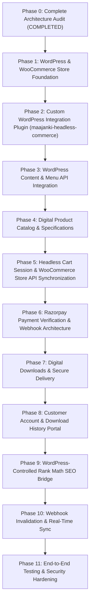

# Master Implementation Plan: Next.js + Headless WordPress Commerce
**Date:** 2026-11-06  

---

## 1. Phased Roadmap

---

## 2. Phase-by-Phase Deliverables

### Phase 1: WordPress & WooCommerce Foundation
- Set currency to **INR (₹)** and business country to **India**.
- Configure digital downloadable settings (Force Downloads or X-Sendfile, disable unnecessary physical shipping).
- Standardize 5 digital product categories:
  1. eBooks & PDF Guides
  2. Website Templates
  3. WordPress Themes & Plugins
  4. Source Code & UI Kits
  5. Digital Courses
- Generate `WORDPRESS_COMMERCE_SETUP.md`.

### Phase 2: Custom WordPress Integration Plugin (`maajanki-headless-commerce`)
- Code the custom plugin under `wp-content/plugins/maajanki-headless-commerce/`.
- Expose `/wp-json/maajanki/v1/` endpoints:
  - `POST /checkout/orders`
  - `POST /checkout/orders/{id}/razorpay`
  - `POST /checkout/orders/{id}/complete`
  - `GET /orders/{id}`
  - `GET /customer/downloads`
- Implement HMAC SHA-256 signature verification to prevent replay attacks.
- Document setup in `WORDPRESS_INTEGRATION_PLUGIN.md`.

### Phase 3 & 4: Storefront & Content Alignment
- Verify Gutenberg block rendering on articles.
- Preserve all existing slugs and URL structures.

### Phase 5 & 6: Cart & Razorpay Payment Verification
- Add server-side Razorpay order generation (`/api/payments/create`) and HMAC signature verification (`/api/payments/verify`).
- Implement idempotent webhook handler (`/api/webhooks/razorpay`) with secret isolation.
- Generate `PAYMENT_FLOW.md`.

### Phase 7 & 8: Secure Digital Delivery & Customer Portal
- Create customer account pages:
  - `/my-account`
  - `/my-account/orders`
  - `/my-account/downloads`
- Grant download permissions only upon verified payment confirmation.

### Phase 9 & 10: SEO & Webhook Synchronization
- Connect Rank Math SEO fields to Next.js `generateMetadata()` on all dynamic pages.
- Verify instant cache purging on publish/update via `/api/webhooks/wordpress`.

### Phase 11: Final Testing & Documentation
- Deliver `FINAL_TEST_REPORT.md`, `SECURITY_AUDIT.md`, `PERFORMANCE_REPORT.md`, and `WORDPRESS_ADMIN_GUIDE.md`.
