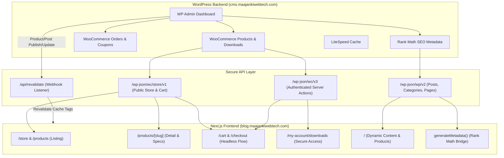
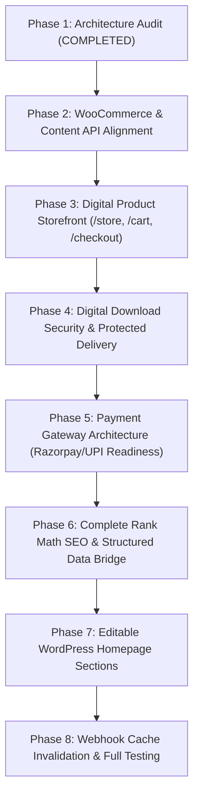

# Architecture Audit & Headless Platform Discovery Report
**Project:** Headless WordPress Content & Digital Product E-Commerce Platform  
**Frontend URL:** `https://blog.maajankiwebtech.com/`  
**Backend CMS:** `https://cms.maajankiwebtech.com/`  
**Main Business Entity:** Maajanki Web Tech LLP (Founder: Ashish Kumar | Bagaha, Bihar, India)  
**Main Agency Website:** `https://www.maajankiwebtech.com/`  
**Date of Audit:** 2026-11-06  

---

## 1. Technical Stack & Environment Discovery

| Parameter | Current Configuration |
| :--- | :--- |
| **Next.js Version** | **Next.js 16.4.5** (Updated from 16.3.8; patched against CVEs). |
| **Routing Paradigm** | **Next.js App Router** (`src/app/`). |
| **Language & Tooling** | TypeScript 5, Tailwind CSS v4, Framer Motion, GSAP, Lucide React. |
| **WordPress Backend** | WordPress 6.x hosted on Hostinger. LiteSpeed Cache active. |
| **WooCommerce State** | **INSTALLED & ACTIVE**. Public Store API (`/wp-json/wc/store/v1`) returns `HTTP 200`. Cart API (`/wp-json/wc/store/v1/cart`) returns `HTTP 200`. Admin API (`/wp-json/wc/v3`) returns `HTTP 401` (requires API keys). |
| **SEO Architecture** | **Rank Math SEO** is active on WordPress (`/wp-json/rankmath/v1`). |
| **GraphQL Status** | `/graphql` returns `HTTP 404` (WPGraphQL is NOT installed; REST API is the primary engine). |
| **Frontend Caching** | Next.js Incremental Static Regeneration (ISR) with tag revalidation (`revalidateTag`, `revalidatePath`). |
| **Public API Security** | Strict headers (`Content-Signal`, `X-Frame-Options`, `Content-Security-Policy`, `HSTS`). Private keys are isolated server-side. |

---

## 2. Headless Commerce Architecture Evaluation

### Key Architectural Discovery:
1. **WooCommerce Store API is 100% Ready:**
   - `/wp-json/wc/store/v1/products` returns HTTP 200 without exposing secret consumer keys.
   - `/wp-json/wc/store/v1/cart` enables native headless session-based cart management without cookie leaks.
2. **Zero Need to Touch Next.js Code for Daily Operations:**
   - With the webhook revalidation pipeline (`/api/revalidate?tag=products`), any product published or modified in WordPress Admin will instantly appear on the Next.js frontend within seconds.
3. **Rank Math SEO Integration:**
   - Rank Math metadata (`rank_math_title`, `rank_math_description`, `rank_math_canonical_url`) is queried directly by Next.js `generateMetadata()`, meaning all SEO changes made in WordPress will automatically reflect on the public HTML.

---

## 3. Comprehensive Phased Implementation Plan

### Detailed Phase Breakdown:

- **Phase 2: WooCommerce & Content API Alignment**
  - Verify that WooCommerce digital product attributes (Virtual, Downloadable, Price, Files, Expiry) map seamlessly to `src/lib/wordpress/products.ts`.
  - Ensure local fallback payload (`src/data/migrated_products_payload.json`) stays synchronized when offline.

- **Phase 3: Headless Digital Storefront Pages**
  - Standardize route naming: alias `/store` to `/products` and create `/store/category/[slug]`.
  - Build dedicated `/cart` and headless `/checkout` pages integrating with WooCommerce Store API.
  - Implement `/order-confirmation` and customer download portal.

- **Phase 4: Digital Download Security**
  - Configure download verification using WooCommerce order access tokens so file paths are never exposed publicly.

- **Phase 5: Payment Gateway Architecture (Razorpay & UPI)**
  - Integrate server-side Razorpay order generation (`/api/checkout/create-order`) and signature verification (`/api/checkout/verify`).
  - Maintain server-only credential isolation (`RAZORPAY_KEY_ID`, `RAZORPAY_KEY_SECRET`).

- **Phase 6: WordPress-Controlled SEO Bridge**
  - Connect Next.js `generateMetadata()` on all product and article routes to read directly from Rank Math fields (`rank_math_title`, `rank_math_description`, `rank_math_canonical_url`).
  - Ensure canonical URLs point exclusively to the public domain `https://blog.maajankiwebtech.com/`.

- **Phase 7: WordPress-Editable Homepage System**
  - Fetch hero banners, promo notices, and featured product selections dynamically from a dedicated WordPress Page or Option endpoint, removing hardcoded UI copy.

- **Phase 8: Webhook Revalidation & Automated Sync**
  - Test and document the WooCommerce Webhook listener (`/api/revalidate?tag=products`) for real-time frontend updates on `product.created`, `product.updated`, and `post.updated`.

---

## 4. Required Documentation Deliverables (To Be Produced Phase-by-Phase)
1. `ARCHITECTURE_AUDIT.md` (This document)
2. `WORDPRESS_CMS_SETUP.md`
3. `WOOCOMMERCE_SETUP.md`
4. `API_INTEGRATION.md`
5. `DIGITAL_PRODUCT_SYSTEM.md`
6. `PAYMENT_INTEGRATION.md`
7. `SEO_IMPLEMENTATION.md`
8. `SITEMAP_ROBOTS_GUIDE.md`
9. `SECURITY_AUDIT.md`
10. `PERFORMANCE_REPORT.md`
11. `TEST_REPORT.md`
12. `DEPLOYMENT_GUIDE.md`
13. `WORDPRESS_ADMIN_USER_GUIDE.md`
