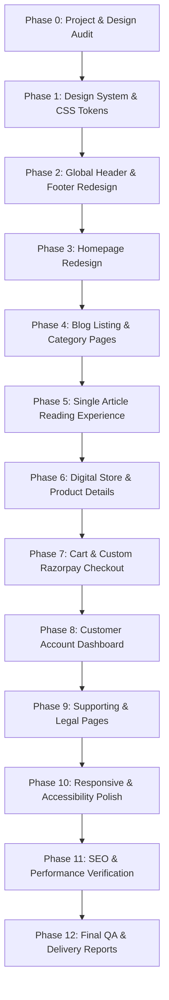

# REDESIGN IMPLEMENTATION PLAN — MAAJANKI WEB TECH
**Scope**: Complete Website Redesign (Editorial Publishing + Digital Product Marketplace)  
**Execution Standard**: Phased, Non-Destructive, Test-Driven  

---

## 1. Architectural Principles

1. **Preserve Working Functionality**: Under no circumstances will existing working API integrations (WordPress REST, WooCommerce, Razorpay payments, webhooks) be disabled or rewritten.
2. **Light-First Editorial SaaS Aesthetic**:
   - Primary: `#DC2564` (Maajanki Magenta/Rose)
   - Secondary: `#14213D` (Navy/Deep Slate)
   - Canvas: `#FFFFFF`
   - Subtle Surface: `#F7F8FC`
   - Borders: Subtle neutral borders (`#E5E7EB`)
   - Elevation: Soft, multi-layered neutral shadows
3. **Strict Next.js 16 & React 19 Hydration Integrity**: Avoid extension traps (`bis_skin_checked`), unmounted state flashes, and client/server timezone formatting discrepancies.

---

## 2. Phase-by-Phase Execution Roadmap

### Phase 0: Existing Project Inspection (COMPLETED)
- Deliverables:
  - `docs/audits/DESIGN_AUDIT.md`
  - `docs/audits/EXISTING_PAGE_INVENTORY.md`
  - `docs/audits/REDESIGN_IMPLEMENTATION_PLAN.md`
- Inspect current Next.js 16 setup, Tailwind v4 tokens, route inventory, and API mapping.

---

### Phase 1: Design System & Global Tokens
- **Target File**: `src/app/globals.css`
- **Actions**:
  - Replace legacy orange (`#ff6b00`) and dark brown palette with official brand tokens:
    - Primary: `#DC2564`
    - Primary Hover: `#B81D52`
    - Primary Light: `#FDF2F5`
    - Secondary: `#14213D`
    - Surface Canvas: `#FFFFFF`
    - Surface Subtle: `#F7F8FC`
    - Border Neutral: `#E5E7EB`
    - Text Primary: `#0F172A`
    - Text Secondary: `#475569`
  - Establish typographic scale classes (`.display-hero`, `.heading-xl`, `.body-editorial`).
  - Standardize button primitives (`.btn-primary`, `.btn-secondary`, `.btn-ghost`).
  - Standardize card primitives (`.card-saas`, `.card-product`, `.card-editorial`).

---

### Phase 2: Global Header & Footer Redesign
- **Target Files**:
  - `src/components/Navbar.tsx`
  - `src/components/Footer.tsx`
  - `src/app/layout.tsx`
- **Header Features**:
  - Clean light-mode header with frosted glass (`backdrop-blur-md bg-white/90`).
  - Maajanki WebTech logo with `#DC2564` accent dot.
  - Primary navigation links with subtle underline animation.
  - Search trigger with quick shortcut / instant dropdown.
  - Shopping Cart bag icon with reactive item counter badge (`#DC2564`).
  - "Explore Store" / "Subscribe" CTA button in `#DC2564`.
  - Accessible mobile drawer menu with smooth spring transition.
- **Footer Features**:
  - 4-column layout:
    - Col 1: Maajanki Brand statement, Bettiah HQ address, social links.
    - Col 2: Editorial Dispatches & Categories.
    - Col 3: Digital Marketplace (Templates, Plugins, Services).
    - Col 4: Legal, Trust seals & Indian GST / LLP verification note.
  - Bottom bar with copyright and privacy links.

---

### Phase 3: Homepage Redesign (`/`)
- **Target File**: `src/app/page.tsx`
- **New Section Hierarchy**:
  1. **Editorial Hero**:
     - Headline: **"Learn. Build. Grow."**
     - Subtitle: *"Practical digital resources, website development insights, SEO guides and tools to help businesses grow online."*
     - Dual CTAs: *"Explore Articles"* (Primary `#DC2564`) + *"Explore Digital Store"* (Secondary `#14213D`).
     - Micro-proof badges: *"500+ Indian Businesses & Developers Served"*, *"100% Genuine Digital Downloads"*.
  2. **Featured Editorial Dispatch & Ticker**:
     - Dynamic hero article card pulled from WordPress (`mainFeaturedPost`).
     - 4 compact curated dispatches (`rightFeaturedPosts`).
  3. **Topic / Category Quick Nav**:
     - Horizontal chip pills for Web Dev, Technical SEO, AI Automation, WordPress, SaaS.
  4. **Digital Marketplace Showcase**:
     - Real WooCommerce products (`HomepageProductsSection.tsx`) with category tabs (Next.js Templates, WordPress Plugins, Agency Services).
  5. **Latest Dispatches (Editorial Grid)**:
     - 8 latest published blog cards in clean 2-column or 3-column layout.
  6. **Why Choose Maajanki (Ecosystem)**:
     - Restyled in clean light-mode cards with `#DC2564` icons.
  7. **Founder Spotlight (Ashish Kumar)**:
     - Clean editorial card highlighting the founder's mission, credentials, and vision.
  8. **Newsletter & Final CTA**:
     - High-converting email capture card with privacy guarantee.

---

### Phase 4: Blog Listing & Category Pages
- **Target Files**:
  - `src/app/blog/page.tsx`
  - `src/components/BlogListingLayout.tsx`
  - `src/app/category/[slug]/page.tsx`
- **Features**:
  - Magazine-style hero with sticky category tab bar.
  - Lead story spotlight card.
  - Responsive article grid with reading time, author avatar, date, and category badge.
  - Numeric pagination.

---

### Phase 5: Single Blog Article Reading Experience
- **Target Files**:
  - `src/app/blog/[slug]/page.tsx`
  - `src/components/TableOfContents.tsx`
  - `src/components/AuthorBioCard.tsx`
- **Features**:
  - Reading-optimized typography (65ch max width, 1.75 line height).
  - Sticky table of contents on desktop left/right rail.
  - Clean syntax-highlighted code snippets with copy button.
  - Contextual Digital Product Callout (e.g. recommend InvoBill on invoicing posts).
  - Social sharing buttons (WhatsApp, X/Twitter, LinkedIn).
  - Interactive comment submission connected to WordPress API.

---

### Phase 6: Digital Store & Product Details
- **Target Files**:
  - `src/app/products/page.tsx` & `src/app/store/page.tsx`
  - `src/app/products/[slug]/page.tsx` & `src/app/product/[slug]/page.tsx`
- **Features**:
  - SaaS product marketplace grid with category filters (Templates, Plugins, Services, Tools).
  - Genuine pricing, instant Add-to-Cart, and instant Buy Now buttons.
  - Product detail page: Gallery preview, feature checklists, compatibility specs (Next.js 16, WP 6.x), instant digital delivery guarantee, FAQ accordion.

---

### Phase 7: Shopping Cart & Custom Razorpay Checkout
- **Target Files**:
  - `src/app/cart/page.tsx`
  - `src/app/checkout/page.tsx`
  - `src/app/order-confirmation/page.tsx`
- **Features**:
  - Stripe/Gumroad-grade cart review with item removal and quantity controls.
  - Frictionless checkout: Customer contact and GST billing details.
  - Verified server-side Razorpay order creation and HMAC verification.
  - Secure order confirmation screen with instantaneous download links.

---

### Phase 8: Customer Account Dashboard
- **Target Files**:
  - `src/app/my-account/page.tsx`
  - `src/app/my-account/orders/page.tsx`
  - `src/app/my-account/downloads/page.tsx`
- **Features**:
  - SaaS-style account portal with left sidebar navigation.
  - Download center with file version indicators and direct download triggers.
  - Order history with downloadable PDF invoice generation.

---

### Phase 9: Supporting & Legal Pages
- **Target Files**:
  - `src/app/about/page.tsx`
  - `src/app/contact/page.tsx`
  - `src/app/privacy-policy/page.tsx`, `terms`, `refund-policy`
- **Features**:
  - Clean agency credentials, founder story, contact cards with Bettiah office map, and standardized legal typography.

---

### Phase 10 to 12: Optimization, Testing & Delivery
- Responsive audit (375px, 768px, 1024px, 1440px).
- Accessibility audit (WCAG 2.2 AA).
- Core Web Vitals audit (LCP, FID/INP, CLS).
- Production deliverables: `DESIGN_SYSTEM.md`, `REDESIGN_CHANGELOG.md`, `FINAL_QA_REPORT.md`.
