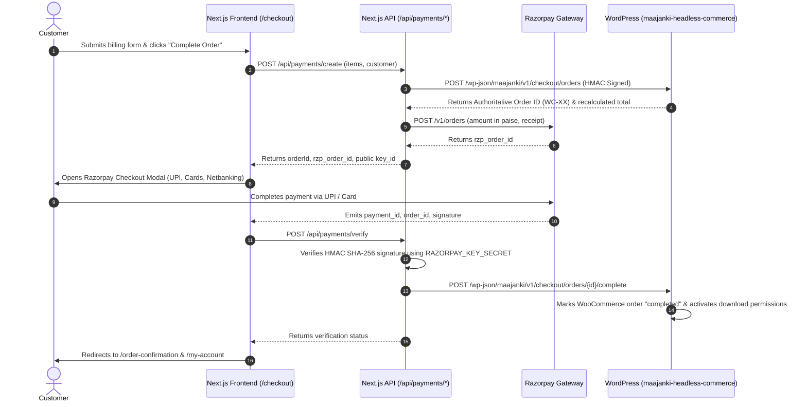

# Payment Integration & Verification Flow (Razorpay + WooCommerce)
**Website:** `https://blog.maajankiwebtech.com/`  
**CMS Backend:** `https://cms.maajankiwebtech.com/` (WooCommerce)  
**Date:** 2026-11-06  

---

## 1. End-to-End Payment Flow



---

## 2. API Endpoints Created

| Endpoint | Method | Responsibility | Security |
| :--- | :--- | :--- | :--- |
| `/api/payments/create` | POST | Contacts WordPress for authoritative price calculation & creates Razorpay order. | Server-side authentication |
| `/api/payments/verify` | POST | Verifies Razorpay HMAC SHA-256 payment signature & informs WordPress to grant digital download access. | Timing-safe crypto verification |
| `/api/webhooks/razorpay` | POST | Asynchronous server-to-server webhook handler for `payment.captured` & `order.paid` events. | HMAC SHA-256 with memory deduplication |
| `/api/webhooks/wordpress` | POST | Receives cache invalidation pings from WordPress when content or products update. | Shared secret key verification |

---

## 3. Environment Variables Configuration

Add the following to your Next.js `.env.local` file:

```bash
# WordPress Integration
WORDPRESS_URL=https://cms.maajankiwebtech.com
WORDPRESS_API_URL=https://cms.maajankiwebtech.com/wp-json
WORDPRESS_INTEGRATION_SECRET=your_32_char_random_secret_here

# Razorpay Configuration
RAZORPAY_KEY_ID=rzp_test_xxxxxxxxxxxxxxxx
RAZORPAY_KEY_SECRET=your_razorpay_secret_here
RAZORPAY_WEBHOOK_SECRET=your_webhook_secret_here

# Webhook Cache Revalidation Secret
WORDPRESS_WEBHOOK_SECRET=maajanki-revalidate-secret
```
